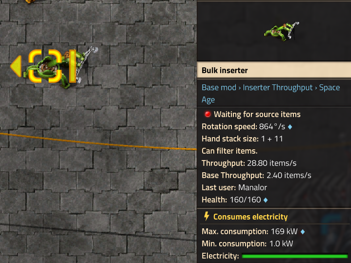

# Inserter Throughput

A Factorio mod that displays the throughput of inserters directly in their tooltip/entity details panel.

## Why This Mod?

While other mods exist that show inserter throughput, none of them felt like they belonged in vanilla Factorio. This mod aims to present throughput information in a way that integrates with the existing factorio tooltips.

## Screenshot

<!-- TODO: Add screenshot of the mod in action -->


## Mod Portal

<!-- TODO: Add link to Factorio Mod Portal page -->
[Download on Factorio Mod Portal](#)

## Building

1. Clone this repository
2. Ensure `info.json` has the correct mod metadata
3. Package the mod:
   ```sh
   git archive --format zip --prefix inserter-throughput/ --worktree-attributes --output inserter-throughput_VERSION.zip HEAD
   ```
4. Place the resulting `.zip` in your Factorio mods folder, or push to `main` to trigger automatic release via GitHub Actions
